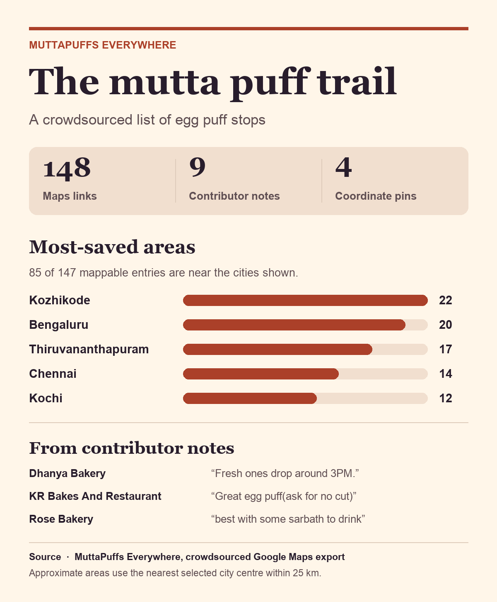

# Mutta Puffs Database

**Mutta Puffs Everywhere** is a community-powered global atlas of mutta puffs, also known as egg puffs. Its source archive is a crowdsourced Google Maps list of bakeries, tea shops, restaurants, landmarks, and standalone pins.

[Explore the atlas](https://subtlesayak.github.io/Mutta-Puffs-Database/) · [Puff Map](https://subtlesayak.github.io/Mutta-Puffs-Database/map/) · [Cities](https://subtlesayak.github.io/Mutta-Puffs-Database/cities/) · [Insights](https://subtlesayak.github.io/Mutta-Puffs-Database/insights/) · [Contribute](https://subtlesayak.github.io/Mutta-Puffs-Database/contribute/) · [About](https://subtlesayak.github.io/Mutta-Puffs-Database/about/)

Use your device location or choose a city, filter by an Indian district, and open a place in Google Maps, Apple Maps, or OpenStreetMap. Each listing has a permanent link with its source and coordinate accuracy.

The [Puff Guide](https://subtlesayak.github.io/Mutta-Puffs-Database/guide/) brings together curated trails, a nearby Roulette draw, and Puff Heritage stories. Puff Passport saves shops and visits in the current browser. Puff Wrapped uses those visits to make an annual recap you can share.

The [Puff Leaderboard](https://subtlesayak.github.io/Mutta-Puffs-Database/leaderboard/) ranks places with at least three approved, first-hand reviews using confidence-adjusted scores. The [Mutta Puff Index](https://subtlesayak.github.io/Mutta-Puffs-Database/price-index/) publishes monthly medians by city and currency and only computes an index for samples of at least three shops. Price and score filters use approved reports.

## Install and contribute from Maps

1. Open the atlas in Android Chrome and choose **Install app** from the browser menu or the button on the Contribute page when it appears.
2. Open a public shop listing or pin in Maps, tap **Share**, and choose **Mutta Puffs** when it appears in the share sheet.
3. Review the prefilled draft, complete the shop details, and choose **Continue on GitHub** to submit it for review with your GitHub account.

On browsers without share-target support, including iPhone Safari, copy the link and paste it into **Contribute → Paste a shared link or location**. At the shop, you can also choose **Use my current location** to fill in a pin. Drafts can be saved on your device while offline. You can also correct a listing, review a puff, or add a photo or a dated price.

## Data

The atlas currently covers **149 places in 5 countries**, with **25 city directories**. Of the 147 places with coordinates, 143 are estimates from saved links and 4 are original dropped pins. Two listings still need coordinates. [Live coverage and downloads](https://subtlesayak.github.io/Mutta-Puffs-Database/about/#data)

[Download the original CSV](data/mutta-puffs-everywhere.csv). It contains 149 rows, including 148 entries with Maps links and one tag-only entry (`Nive backery`). The original titles, notes, URLs, tags, comments, and row order are preserved. Four links point directly to coordinates. Places with the same name and different links have their own rows.

| Column | Contents |
| --- | --- |
| `Title` | Place name or pin label in the export |
| `Note` | Contributor note about the place |
| `URL` | Google Maps place link or coordinate pin |
| `Tags` | Labels saved with the entry |
| `Comment` | Comment field from the export |

## Browse places and explore the analysis

- [Place directory](analysis/PLACES.md) with clickable Google Maps, Apple Maps, and OpenStreetMap links
- [Summary and count tables](analysis/README.md)
- [Offline report](analysis/index.html) with the searchable list, district filter, coverage charts, and contributor notes. Download the HTML and open it in a browser.
- [Analysis CSV](analysis/places.csv) with the source fields, source row numbers, and derived fields for each entry
- [Summary JSON](analysis/summary.json) with the counts, coverage gaps, and duplicate checks

## Analysis method

- **Geography.** Four direct pins supply coordinates. For other mappable links, the analysis interprets the first Maps feature ID component as an [S2 cell](https://s2geometry.io/devguide/s2cell_hierarchy) and uses its estimated centre. Country and Indian state assignments use [Natural Earth 5.1.2](https://github.com/nvkelso/natural-earth-vector/tree/v5.1.2) public-domain boundaries. A point just outside can be assigned when exactly one boundary is within 2 km. The analysis records this method and leaves ambiguous assignments blank.
- **City areas.** Each point is counted once at the closest selected city centre within 25 km. Those groups can include suburbs and nearby towns. The interactive Puff Map shows the worldwide coverage. The archived report opens on southern India.
- **Districts.** Contains [geoBoundaries India ADM2 data](https://www.geoboundaries.org/api/current/gbOpen/IND/ADM2/) from Pathways Data Pvt. Ltd. and the Local Government Directory, under the [Open Database License 1.0](https://opendatacommons.org/licenses/odbl/1-0/). The included [district snapshot](data/reference/geoboundaries-ind-adm2-9469f09.json.gz) repackages the simplified 2021 polygons. District assignments use those polygons or a unique district within 2 km of an estimated point and can differ from current boundaries.
- **Nearby search.** Results sort by straight-line distance from the chosen city centre or the location your browser shares. The page uses that location in memory for sorting and filtering.
- **Place types.** Title keywords suggest one primary type per entry. The CSV also includes all matching type signals. A hospital, cinema, or other landmark is kept so contributors can identify the actual stall or shop later.
- **Notes.** Contributor wording is preserved. Topic counts recognise explicit terms for fillings, preparation, availability, and pairings. One note can contribute to several topics. The export has no timestamps, current business hours, prices, or Google review counts.
- **Duplicates.** Exact URLs and stable Maps targets are checked separately. Similar titles with different targets stay as separate entries. Coordinate pin labels are excluded from the repeated listing-title check.
- **Map links.** Google Maps opens the original saved link. Apple Maps and OpenStreetMap search by title for listings and use the saved coordinates for direct pins. Alternate providers may return multiple results. **Nive backery** is a tag-only entry and needs a map link.
